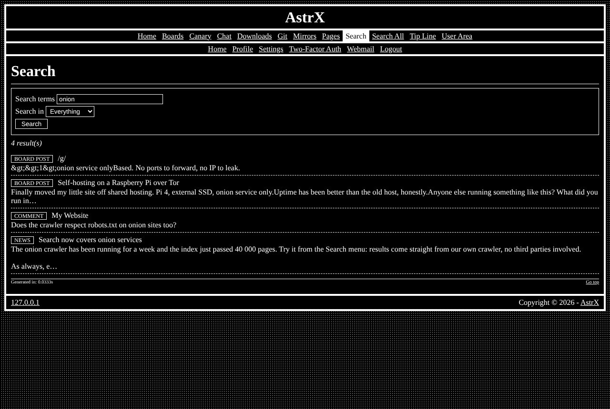

# astrx/module-search

Site-wide full-text search with its index crawler — the **Search** module of [AstrX](https://github.com/Vxmdzhb/astrx).



- Module key: `search` (switch it on in the site's `resources/config/Modules.config.php`)
- Pages: `admin_search`, `site_search`
- Requires: `astrx/cms`, `astrx/framework`, `astrx/library`

The Search page is the site's one search box. Its first tab, **This site**,
searches news, pages, comments and board posts through a MariaDB FULLTEXT
index (`php tools/search_index.php` rebuilds it; Admin → Search index queues a
rebuild). Other modules add tabs: the engine modules
([module-websearch](https://github.com/Vxmdzhb/module-websearch),
[module-onionsearch](https://github.com/Vxmdzhb/module-onionsearch),
[module-torrentsearch](https://github.com/Vxmdzhb/module-torrentsearch))
each add one. A tab is any class implementing `AstrX\Search\Tab\SearchTab`,
listed under `extensions` in its module's manifest:

```php
'extensions' => [\AstrX\Search\Tab\SearchTab::class => [MyTab::class]],
```

`search()` returns a `SearchTabPage` of `SearchHit`s (a title, a link, a
snippet, facts, links, files), which the page draws the same way for every
tab; `order()` places the tab. A tab whose engine is down says so, and the
other tabs keep working. Switch a module off and its tab goes with it.

It ships its own templates, catalogs (en, it), default configuration and SQL in
`resources/`; the site overrides any of them from its own `resources/`.

AstrX isn't on Packagist and doesn't tag versions: you install from each
repository's `main`, and your `composer.lock` pins the exact commit. Tell
Composer where to find the package and the AstrX packages it depends on:

```json
{
    "minimum-stability": "dev",
    "prefer-stable": true,
    "repositories": [
        { "type": "vcs", "url": "https://github.com/Vxmdzhb/module-search" },
        { "type": "vcs", "url": "https://github.com/Vxmdzhb/cms" },
        { "type": "vcs", "url": "https://github.com/Vxmdzhb/framework" },
        { "type": "vcs", "url": "https://github.com/Vxmdzhb/library" }
    ]
}
```

Then:

```sh
composer require astrx/module-search:dev-main
```

After that, list `AstrX\Search\SearchModule::class` in the
site's `ApplicationModules::INSTALLED` and run the installer to create its
tables. See [modules](https://github.com/Vxmdzhb/astrx/blob/main/docs/MODULES.md).

Issues and pull requests are welcome here. [AstrX](https://github.com/Vxmdzhb/astrx)
is the site that puts all the packages together.
